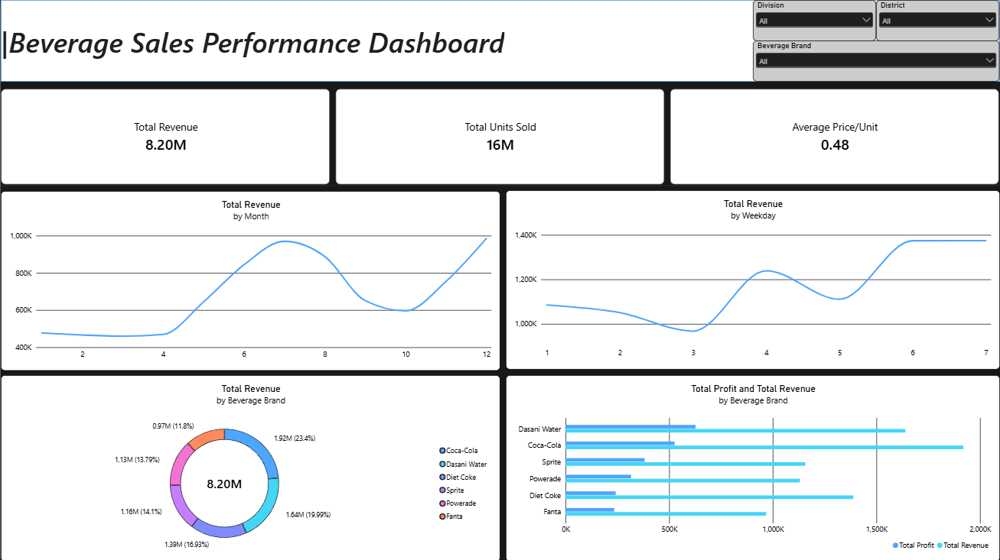

# Beverage Sales Performance Dashboard
### Interactive sales, revenue, and profitability analysis using Microsoft Power BI



## 1. Project Overview

The **Beverage Sales Performance Dashboard** is an interactive Power BI report designed to help users understand sales performance across beverage brands, divisions, districts, months, and weekdays.

The dashboard brings key performance indicators and sales trends into one view so that users can explore overall results and investigate differences between brands and locations.

**Tools used:** Microsoft Power BI, Power Query, DAX, Data Modeling, Interactive Visualizations.

**Business focus:** Revenue monitoring, sales volume analysis, average selling price, brand-level revenue and profit comparison, and time-based sales trends.

---

## 2. Business Problem

A beverage business needs to monitor how much revenue it generates, how many units it sells, how sales change over time, and how different beverage brands perform. Looking at transaction-level data alone can make it difficult to compare brands or investigate performance by location and time period.

The main business questions addressed by this dashboard are:

- What are the total sales revenue and total units sold?
- What is the average price per unit?
- How does revenue change from month to month?
- How does revenue vary by weekday?
- Which beverage brands contribute the most revenue?
- How do brand-level revenue and profit compare?
- How can performance be explored for a selected division, district, or beverage brand?

### Business objective

Create a consolidated, interactive view of sales performance that helps users monitor key metrics, identify patterns in the available data, and make more informed follow-up decisions.

> The dashboard supports analysis and decision-making; it does not, by itself, prove why a trend occurred or guarantee an improvement in sales or profit.

---

## 3. Data Sources and Model

The Power BI file contains three tables:

| Table | Role | Main fields |
|---|---|---|
| `Data` | Sales transaction table | Retailer, Retailer ID, Date, Month, Division, District, Beverage Brand, Price per Unit, Units Sold, Cost per Unit |
| `Dates` | Date dimension | Date, Year, Month, Weekday |
| `Cost` | Beverage-brand cost lookup | Beverage Brand, Production Cost per Unit |

The workbook contains **3,739 sales records** in the `Data` table, along with a date table covering 2022 and a cost lookup table containing six beverage brands.

### Relationships

The model uses these relationships:

```text
Dates[Date] (1) ───────── (*) Data[Date]

Cost[Beverage Brand] (1) ─ (*) Data[Beverage Brand]
```

- `Dates` provides calendar attributes for time-based analysis.
- `Cost` provides production cost per unit for each beverage brand.
- `Data` contains the sales records used by the measures and visuals.

The lookup side should contain unique keys: one row per date in `Dates`, and one row per beverage brand in `Cost`.

---

## 4. Data Cleaning and Preparation

The data was prepared in Power Query / Power BI before building the report.

Cleaning and preparation steps included:

- Applied **Trim** to remove leading and trailing spaces in text fields.
- Applied **Clean** to remove unwanted non-printing characters.
- Removed unnecessary columns that were not needed for the analysis.
- Reviewed and applied appropriate data formatting and data types for analysis.
- Prepared the tables for relationship-based modeling rather than relying on a single flattened table.

These steps help improve consistency and make fields easier to use in relationships, slicers, calculations, and visuals.

---

## 5. DAX Measures

The measures were organized in a dedicated table named **`Analytics`** to keep the model and report calculations organized.

### Total Revenue

```DAX
Total Revenue =
SUMX(
    Data,
    Data[Price per Unit] * Data[Units Sold]
)
```

Calculates revenue for each sales row and adds the results.

### Total Units Sold

```DAX
Total Units Sold =
SUM(Data[Units Sold])
```

Adds the units sold across the filtered sales records.

### Average Price per Unit

```DAX
Average Price per Unit =
AVERAGE(Data[Price per Unit])
```

Calculates the arithmetic average of the `Price per Unit` column. This is not necessarily the same as weighted average selling price.

### Total Profit

The profit measure uses selling price, production cost per unit, and units sold. The cost lookup is retrieved through the relationship with the `Cost` table.

```DAX
Total Profit =
SUMX(
    Data,
    VAR Profit =
        Data[Price per Unit] -
        RELATED(Cost[Production Cost per Unit])
    RETURN
        Profit * Data[Units Sold]
)
```

Calculates row-level profit and then sums it across the sales records. This measure assumes that the relationship between `Cost` and `Data` is active and that each beverage brand maps to one production cost.

---

## 6. Dashboard Components

### KPI Cards
- **Total Revenue:** overall revenue in the current filter context.
- **Total Units Sold:** total units sold.
- **Average Price/Unit:** arithmetic average of the listed unit prices.

### Time-based line charts
- **Total Revenue by Month:** compares revenue across the months of the year.
- **Total Revenue by Weekday:** compares revenue across weekday categories.

### Brand analysis
- **Revenue by Beverage Brand (donut chart):** shows each brand's share of total revenue.
- **Total Profit and Total Revenue by Beverage Brand (clustered bar chart):** compares revenue and profit for each brand.

### Interactive slicers
- Division
- District
- Beverage Brand

The slicers allow users to filter the report and inspect performance for selected geographic areas and brands.

---

## 7. Key Findings from the Current Dashboard

The figures below are the values displayed in the supplied dashboard screenshot. They may change when slicers are applied.

### Overall KPIs

- **Total Revenue:** approximately **$8.20M**
- **Total Units Sold:** approximately **16M**
- **Average Price per Unit:** approximately **$0.48**

### Monthly revenue pattern

The monthly line chart shows revenue starting at a relatively low level early in the year, increasing notably toward the middle of the year, declining around September–October, and rising again toward December. The chart suggests variation in monthly sales performance and identifies periods worth investigating further.

### Weekday revenue pattern

Revenue varies across the seven weekday categories. The chart shows relatively lower revenue around weekday category 3 and higher values around categories 6 and 7. The current x-axis displays weekday numbers (1–7), so the weekday mapping should be checked or replaced with weekday names for easier interpretation.

### Revenue contribution by brand

The donut chart displays the following approximate brand-level revenue values:

| Beverage brand | Revenue shown | Share shown |
|---|---:|---:|
| Coca-Cola | $1.92M | 23.4% |
| Dasani Water | $1.64M | 20.0% |
| Diet Coke | $1.39M | 16.9% |
| Sprite | $1.16M | 14.1% |
| Powerade | $1.13M | 13.8% |
| Fanta | $0.97M | 11.8% |

Coca-Cola has the largest revenue contribution in the displayed chart, while Fanta has the smallest. These figures describe revenue contribution, not profitability.

### Revenue versus profit

The clustered bar chart compares total revenue and total profit across the six beverage brands. It makes the difference between sales volume in monetary terms and profit visible, helping users avoid judging brand performance from revenue alone. The chart does not display exact profit data labels, so precise profit rankings or values should be confirmed from the underlying measures before being reported.

---

## 8. Business Value

The dashboard provides a single interactive view for:

- Monitoring overall revenue and sales volume.
- Reviewing average listed unit price.
- Identifying monthly and weekday revenue patterns.
- Comparing beverage brands by revenue and profit.
- Exploring performance by division, district, and beverage brand.
- Identifying areas that may deserve deeper investigation.

The findings can guide further questions about sales planning, distribution, inventory, pricing, and brand strategy. Additional operational or historical data would be needed to determine the causes of the observed patterns.

---

## 9. Project Summary

**Project name:** Beverage Sales Performance Dashboard  
**Platform:** Microsoft Power BI  
**Project type:** Descriptive sales analytics and interactive reporting

This project demonstrates data cleaning, relational data modeling, DAX measure creation, KPI design, time-based trend analysis, brand-level comparison, and interactive filtering in Power BI.
